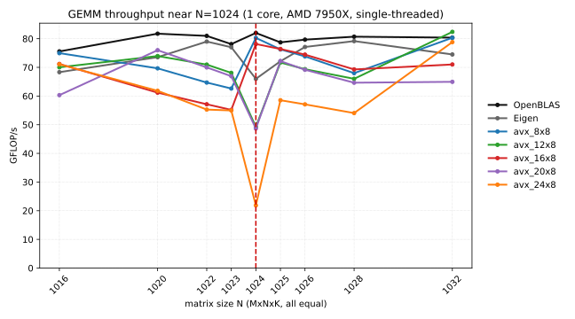
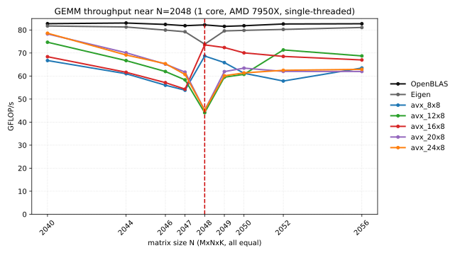

# ESTZero: Electronic Structure Theory implementations from scratch

An electronic structure engine built using C++ that is optimized over time. The current repository supports RHF/UHF references and SCF/MP2 methods. Some supplemental methods are also implemented, including `einsum` and `diis`. The integrals are evaluated using `libint2`, and the linear algebra library used is `Eigen`. The newest versions are also focusing on writing a General Matrix Multiplication (GEMM) manually to use as the backend of `einsum`, along aside other established libraries like `Eigen` and `OpenBLAS`.

The test used to evaluate the performance of the engine is formaldehyde at the def2-tzvp basis set. The accuracy and performance is benchmarked against Psi4. 

## References

This repository is inspired by the following projects, which are also the references for the equations and programming materials:

**Electronic Structure Theory**
- Psi4Numpy: https://github.com/psi4/psi4numpy/
- CCQC's summer program: https://github.com/CCQC/summer-program
- Dr. Crawford's C++ Programming Projects: https://github.com/CrawfordGroup/ProgrammingProjects/
- Dr. Crawford's PyCC: https://github.com/CrawfordGroup/pycc/

**General Matrix Multiplication**
- https://github.com/flame/how-to-optimize-gemm
- https://github.com/flame/blislab

## Benchmarking

A benchmark + accuracy suite lives in `bench/`. It runs the engine over a tiered test suite and checks every energy against a cached Psi4/PK reference.

```bash
# 1. store Psi4 reference energies:
python bench/gen_reference.py

# 2. benchmark + accuracy check (rebuilds, best-of-3 wall time, PASS/FAIL vs Psi4):
python3 bench/benchmark.py
```

Psi4 options:
```bash
e_convergence 1e-8
d_convergence 1e-8
maxiter 200
scf_type pk # no density-fitting
guess core

mp2_type conv
freeze_core false
```

## 1. GEMM Microbenchmark

Starting from version 3.0.0, the focus shifted to optimizing the backend of the manually implemented `einsum`, which is the backbone of the post-HF methods implemented here. This update wired Eigen to call GEMM instead of the previous odometer scheme for `einsum` contractions. Version 3.1.0 introduced a specialized microbenchmark for GEMM, with the intention to walk up the optimization ladder starting from the naive baseline GEMM. Version 3.1.1 reorganized the route naming into three families: `naive_*` (unoptimized references), `mkn_RxR` (loop order `mnk`, blocks rows of A reused against B), `mnk_RxR` (tiles a block of C held as accumulators that live in registers across the k reduction, or "register blocking"). Version 3.1.3/3.1.4 added a fourth family, `avx_RxNR`, using `<immintrin.h>` AVX-512 intrinsics directly instead of hoping the auto-vectorizer packs named scalar accumulators (`avx_12x8`/`avx_16x8`/`avx_20x8`/`avx_24x8` are generated using macros from the same logic as `avx_8x8`).

The results reported here are timings for a matrix multiplcation task: C = alpha\*\(A\*\B) + beta\*\C. Single-core peak GFLOPs on this machine (AMD Ryzen 9 7950X) = ~4.5 clock(GHz) * 8 doubles/zmm * 2 FMA units * 2 flops/FMA = 144 GFLOPs. GFLOPs of each run is calculated as (2.0 * M * N * K) / (avg_ms * 1e6).

```bash
python3 bench/gemm_bench.py                                                  # default: avx_*/openblas/eigen at size 510,1022,2045
python3 bench/gemm_bench.py --legacy --sizes 1022                            # include the frozen naive/mkn/mnk routes
python3 bench/gemm_bench.py --routes openblas,avx_8x8,mkn_8x1 --sizes 1022   # just these
```

### Full ladder snapshot (frozen as of v3.1.4, before packing)

Shape: 2045x2045x2045
| Route | Avg(ms) | %OpenBLAS | GFLOP/s | %Peak | IPC | L1miss% | LLCmiss% | Note |
| --- | --- | --- | --- | --- | --- | --- | --- | --- |
| OpenBLAS | 206.905 | 100.0 | 82.67 | 57.4 | 0.97 | 22.32 | 0.29 | - |
| Eigen | 213.556 | 96.9 | 80.09 | 55.6 | 0.92 | 25.21 | 1.46 | - |
| avx_12x8 | 379.929 | 54.5 | 45.02 | 31.3 | 0.72 | 31.45 | 3.47 | closest to OpenBLAS, every row's address offset fits directly in a GPR |
| avx_24x8 | 396.620 | 52.2 | 43.13 | 29.9 | 0.80 | 22.96 | 2.94 | MR=24>GPR=16, so the compiler reloads from outside, but the tradeoff is less k loops |
| avx_20x8 | 405.196 | 51.1 | 42.21 | 29.3 | 0.76 | 27.80 | 2.75 | similar to `avx_20x8` |
| avx_8x8 | 446.237 | 46.4 | 38.33 | 26.6 | 0.72 | 31.82 | 5.41 | correctly vectorized accumulators sitting in registers |
| avx_16x8 | 561.847 | 36.8 | 30.44 | 21.1 | 0.68 | 34.28 | 3.28 | worst of the `avx_Rx8`, *not fully explained* |
| mkn_8x1 | 942.814 | 21.9 | 18.14 | 12.6 | 1.09 | 19.42 | 0.15 | best of pre-avx family, reusing B 8 times |
| mkn_4x1 | 1026.760 | 20.2 | 16.66 | 11.6 | 1.03 | 20.85 | 0.19 | similar to above |
| mnk_4x4 | 1293.532 | 16.0 | 13.22 | 9.2 | 2.26 | 33.79 | 0.31 | 16 named accumulators, fit in register but non-contiguous A fetches |
| mnk_8x8 | 1329.830 | 15.6 | 12.86 | 8.9 | 2.36 | 11.77 | 0.67 | 64 named accumulators, spills out of register |
| naive_mkn | 1358.154 | 15.2 | 12.59 | 8.7 | 0.81 | 17.53 | 1.23 | previously beat all of the pre-avx versions in 1022, but in the larger size 2045 the blocking scheme showed work |
| avx_1x8 | 1622.559 | 12.8 | 10.54 | 7.3 | 0.69 | 64.86 | 14.80 | only having one vectorized accumulator in register, it could not utilize the loaded B row fully  |
| mnk_8x1 | 1636.388 | 12.6 | 10.45 | 7.3 | 1.91 | 59.81 | 0.07 | better than `mnk_8x1` despite non-contiguous A fetches |
| mnk_1x4 | 1884.383 | 11.0 | 9.08 | 6.3 | 1.31 | 45.30 | 1.26 | compared to `mnk_1x4`, the situation is flipped here vs the x8 variant |
| mnk_1x8 | 2247.778 | 9.2 | 7.61 | 5.3 | 0.74 | 36.03 | 9.88 | worse than `mnk_1x8` despite contiguous B fetches |
| mnk_4x1 | 2941.667 | 7.0 | 5.81 | 4.0 | 1.25 | 60.72 | 1.22 | compared to `mnk_4x1`, the situation is flipped here vs the x8 variant |
| naive_mnk | 7640.584 | 2.7 | 2.24 | 1.6 | 1.30 | 55.82 | 3.18 | unblocked, wrong innermost loop variable k. (baseline naive) |

### Dense sweep around powers of 2

N=1024 makes every `avx_Rx8` route noticeably worse than its neighbor, i.e. N=1022. Sweeping densely around N=1024 and N=2048 (`bench/gemm_sweep.py`, avx-focused, one run per size) shows this spike only happens exactly at the power of two:




`avx_16x8` (the fastest hand written route):

| Center | N-1 | **N (exact power of 2)** | N+1 |
| --- | --- | --- | --- |
| 1024 | 70.6% of OpenBLAS | **95.3%** | 97.1% |
| 2048 | 66.3% of OpenBLAS | **89.5%** | 88.7% |

See `bench/outputs_gemm/sweep_1024.log` / `sweep_2048.log` for full details.

```bash
python3 bench/gemm_sweep.py                                       # sweep around 1024 and 2048 (avx_* + openblas/eigen only)
python3 bench/gemm_sweep.py --centers 3072 --offsets=-4,-2,0,2,4  # sweep around any other center
```

## 2. EST Performance log

This log tracks the update in features and their performance in the most computationally costly steps of different electronic structure theory methods. Versions without algorithm update for each section is not documented. See `bench/outputs` for full version peformance logs.

> v1.5.0 added the ERI tensor building scheme alongside the original ERI vector building, so for this version both schemes are shown for direct comparison. From this version onward, only ERI tensor performance is shown.

> v1.5.2 switched `Tensor`'s element access (`operator()`/`flat_index`) to bounds-checked `std::vector::at()` as part of the shared_ptr-backed zero-copy view rewrite (`swapaxes`/`slice`). Since `Tensor` is the storage type behind the ERI tensor scheme, `build_JK`, and the `einsum`-driven MO transform, this regressed every section below that touches it — most visibly UHF MP2's MO transform, which lost the v1.5.1 fix's gains. v1.5.3 replaces `.at()` with unchecked indexing (safe here, since every call site already guarantees in-bounds access), restoring MP2 to v1.5.1 levels and improving ERI/JK further; the remaining ERI gap vs. the v1.5.0 vector scheme is now fully explained by the tensor scheme's inherent 8-fold permutation writes per integral, not indexing overhead.

> Starting from version v3.0.0, the optimization are focused on the backend of `einsum`, so it will impact post-HF algorithms about equally, depending on the intensity of the number of `einsum` calls. This is a major speed up for methos like MP2, MP3 and CCSD/CCSD(T). These changes are summarized here in short instead of given in the notes below. To see the full changes, see `CHANGELOG.md`
> - v3.0.0 added **Eigen GEMM for `einsum`**. The GEMM setup, however, require the contiguous buffer from Tensor, and in some cases it creates copies, so the memory footprint is higher. 
> - v3.0.1 added a minimum-size guard before calling GEMM (decline to the odometer scheme if an operand was too small), to avoid GEMM setup overhead on the many small contractions in the CCSD(T) "vikings" perturbative-triples loop. The guard checked **every** operand independently, which turned out to be the wrong criterion — see v3.0.3 below.
> - v3.0.2 added **OpenBLAS GEMM for `einsum`**. The performance is still superior to pre v3.0.0, compared to Eigen it's generally worse, especially for CCSD(T) with high intensity of `einsum` calls.
> - v3.0.2a fixed **threading=1 for OpenBLAS GEMM**. The allowed threading by default for OpenBLAS in the previous version created significant overhead, relative to the small system size used here.
> - v3.0.3 fixed the v3.0.1 guard, now gating on the contraction's total work (`left_size * summed_size * right_size`) rather any operand's raw element count. **v3.0.1 through v3.0.2a all ran with this bug, so the Eigen vs OpenBLAS comparison in those versions is unreliable. v3.0.3 (eigen) vs. v3.0.3 (blas) is the first fair comparison between the two backends.**

### SCF

For RHF, the test used to track through different versions is benzene/def2-svp (nbf=114), as it has a sufficiently large number of basis functions for testing. The baseline version, v0.1.0, uses in-core 4-index ERIs (no permutational symmetry, no screening), dense N^4 JK build, DIIS, symmetric orthogonalization, core guess.

#### RHF

| version | Total wall (s) | ERI build (s) | JK build (per iter) (ms) | N_SCF_iter | Peak RSS (MB) | Note |
|---|---|---|---|---|---|---|
| v0.1.0 | 28.736 | 9.789 | 1182.5 | 16 | 177.1 | SCF Baseline |
| v0.1.1 | 18.882 | 9.588 | 579.2 | 16 | 177.1 | Moved eri index helpers defintion to header file to reduce overhead |
| v0.2.0 | 10.526 | 1.348 | 527.0 | 16 | 176.9 | Build ERI now loops over shell quartets (~8x speed up) |
| v0.3.0 | 7.075 | 1.346 | 356.4 | 16 | 177.0 | Added scattering for JK building (similar ERI looping, scatter J twice and K four times, and symmetry) |
| v0.4.0 | 7.061 | 1.343 | 355.7 | 16 | 175.5 | Reorganize code around wavefunction object (no algorithm optimization) |
| v1.5.0 (vector) | 8.450 | 1.356 | 441.8 | 16 | 176.6 | Slightly slower JK build compared to v0.4.0 (reorganization effects) |
| v1.5.0 (tensor) | 5.727 | 2.535 | 193.7 | 16 | 1300.8 | ERI build ~2x slower, JK build ~2.3x faster, and RSS ~7.4x as the vector exploited the 8-fold symmetry |
| v1.5.2 | 4.018 | 1.756 | 139.7 | 16 | 1301.0 | Tensor's shared_ptr view rewrite (`swapaxes`/`slice`) switched element access to bounds-checked `.at()`, regressing every Tensor-touching phase |
| v1.5.3 | 3.985 | 1.769 | 136.7 | 16 | 1301.0 | Fix: `.at()` replaced with unchecked indexing in `Tensor`. JK faster than v1.5.2; ERI still slower than v1.5.0 (vector), now purely from the 8-fold write expansion, not indexing overhead |

#### UHF

Version 1.1.0 reorganize the benchmark suite to separate the reference and the method; UHF is added as an additional reference to the previous RHF, with the methods being SCF and MP2. The benchmark system for UHF is •CH3 methyl radical/aug-cc-pvtz (nbf=115). The baseline for UHF SCF is similar to RHF SCF version 0.4.0, but with separate alpha and beta terms following the Pople-Nesbet equations.

| version | Total wall (s) | ERI build (s) | JK build<sup>(1)</sup> (per iter) (ms) | N_SCF_iter | Peak RSS (MB) | Note |
|---|---|---|---|---|---|---|
| v1.1.0 | 13.998 | 1.020 | 862.6 | 15 | 188.2 | UHF SCF Baseline |
| v1.5.0 (vector) | 16.248 | 1.028 | 1012.0 | 15 | 187.9 | Slightly slower JK build compared to v1.1.0 (reorganization effects) |
| v1.5.0 (tensor) | 7.971 | 2.216 | 376.2 | 15 | 1352.9 | Similar speed up to RHF, but build JK is significantly faster because of both alpha and beta building per iteration |
| v1.5.2 | 5.835 | 1.465 | 288.5 | 15 | 1352.9 | Same `.at()` regression as RHF SCF (`Tensor` is shared across references) |
| v1.5.3 | 5.725 | 1.460 | 281.6 | 15 | 1352.9 | Same fix and gains as RHF SCF |

> (1) Total time for both alpha and beta calculation time per iteration

### MP2

Version v1.0.0 included MP2 for RHF. The baseline is the 4 step MO transformation written via explicit loops ~ O(N^5). The calculation runs a base SCF first, so ERI build and JK build performance is similar to versions above. The benchmarking system used here is similar to SCF, which is benzene/def2-svp (nbf=114).

| version | Total wall (s) | ERI build (s) | JK build (per iter) (ms) | N_SCF_iter | MO transform(s) | MP2 energy (ms) | Peak RSS (MB) | Note |
|---|---|---|---|---|---|---|---|---|
| v1.0.0 | 29.570| 1.346 | 407.7 | 16 | 21.666 | 6.9 | 607.4 | MP2 Baseline |
| v1.3.0 | 30.093 | 1.350 | 400.5 | 16 | 22.287 | 20.6 | 4279.4 | MO transform rewired through a from-scratch `einsum` (CCSD prep). Peak RSS ~7x (see `CHANGELOG.md`) |
| v1.3.1 | 31.412 | 1.375 | 449.5 | 16 | 22.797 | 21.3 | 2753.1 | Fix `einsum` memory bug (see `CHANGELOG.md`) |
| v1.5.0 (vector) | 32.390 | 1.359 | 459.1 | 16 | 23.635 | 21.2 | 2753.6 | Similar to v1.3.1 |
| v1.5.0 (tensor) | 27.940 | 2.528 | 193.1 | 16 | 22.212 | 20.6 | 1796.1 | Similar speed up to RHF, and RSS much more sufficient because ERI conversion from vector to tensor is not needed |
| v1.5.2 | 30.729 | 1.754 | 140.0 | 16 | 26.701 | 5.7 | 1732.1 | Same `.at()` regression as SCF above; the `einsum`-driven MO transform is Tensor-heavy so it's hit too |
| v1.5.3 | 27.308 | 1.764 | 136.2 | 16 | 23.332 | 5.8 | 1732.1 | Fix restores MO transform/MP2 to v1.5.1-level speed; see SCF note above |
| v1.5.5a | 28.592 | 1.762 | 136.8 | 16 | 24.527 | 215.5 | 1732.3 | Wired in `einsum` for MP2 energy evaluation. ~40x slow down due to `einsum` not having pairwise evaluation, so *`iajb,iajb,iajb->` is extremely slow* (Correction below) |
| v1.5.5b<sup>(2)</sup> | 28.585 | 1.764 | 136.9 | 16 | 24.375 | 227.0 | 1732.3 | Wired `einsum` with two operands and intermediates. Performance is slightly worse, `einsum` wasn't a problem for this case the 4 indices are the same; `Tensor` setup fixed cost is what hit |
| v3.0.0 | 6.340 | 1.734 | 135.6 | 13 | 2.320 | 498.5 | 2551.6 | **Eigen GEMM for `einsum`** |
| *v3.0.2* | 6.052 | 1.749 | 136.4 | 13 | 1.976 | 521.9 | 2452.0 | **OpenBLAS GEMM for `einsum`** |
| *v3.0.2a* | 6.144 | 1.724 | 137.3 | 13 | 2.127 | 481.2 | 2363.6 | **Fix threading=1 for OpenBLAS GEMM** |
| v3.0.3 (eigen) | 6.388 | 1.740 | 136.4 | 13 | 2.343 | 498.5 | 2557.3 | **Fixed v3.0.1 GEMM-size guard** |
| v3.0.3 (blas) | 6.224 | 1.740 | 137.1 | 13 | 2.171 | 498.2 | 2368.1 | **Fixed v3.0.1 GEMM-size guard** |

> (2) Version v1.5.5c tried replacing all `einsum` with `Tensor` arithemic operators, but performance is identical, showing the fixed cost lie in `Tensor` setups.

#### UHF

UHF MP2 are built on top of the Ca and Cb matrices to transform ERI into the alpha-alpha, beta-beta, and alpha-beta MO integral tensors. Baseline version (v1.1.0): the index transform function used is similar to the one used for RHF MP2 to build alpha-alpha and beta-beta tensors; the alpha-beta block is built from the intermediate tensor after index 2 transformation of the alpha-alpha tensor. The benchmarking system used here is similar to SCF, which is •CH3 methyl radical/aug-cc-pvtz (nbf=115).

| version | Total wall (s) | ERI build (s) | JK build<sup>(1)</sup> (per iter) (ms) | N_SCF_iter | MO transform<sup>(1)</sup> (s) | MP2 energy (ms) | Peak RSS (MB) | Note |
|---|---|---|---|---|---|---|---|---|
| v1.1.0 | 21.285 | 1.024 | 905.5 | 15 | 6.635 | 0.8 | 393.1 | UHF MP2 Baseline |
| v1.3.0 | 28.646 | 1.036 | 839.4 | 15 | 14.976<sup>(3)</sup> | 2.1 | 4255.5 | Same `einsum` rewrite as RHF MP2 above. Peak RSS ~11x. |
| v1.3.1 | 29.826 | 1.043 | 939.0 | 15 | 14.655 | 2.3 | 2857.3 | Fixed `einsum` memory bug |
| v1.5.0 (vector) | 31.203 | 1.032 | 972.4 | 15 | 15.542 | 2.2 | 2856.6 | Similar to v1.3.1 |
| v1.5.0 (tensor) | 22.084 | 2.213 | 378.6 | 15 | 14.099 | 2.0 | 1471.4 | Similar improvement to RHF MP2 |
| v1.5.1 | 17.049 | 2.077 | 375.0 | 15 | 9.293<sup>(3)</sup> | 2.1 | 1466.4 | Fix: Use intermediate 2 of Iaa to build Iab directly |
| v1.5.2 | 17.281 | 1.461 | 288.2 | 15 | 11.454 | 0.9 | 1466.3 | Same `.at()` regression; MO transform lost v1.5.1's gain despite no algorithm change |
| v1.5.3 | 15.568 | 1.458 | 280.9 | 15 | 9.855 | 0.8 | 1466.5 | Fix restores MO transform/MP2 to v1.5.1 level |
| v1.5.5a | 16.173 | 1.464 | 282.6 | 16 | 10.375 | 52.8 | 1466.9 | Same as in RHF MP2. ~66x slow down, which is worst than RHF MP2 due to the additional alpha beta mixing terms |
| v1.5.5b | 16.105 | 1.457 | 280.7 | 16 | 10.367 | 30.0 | 1466.9 | Wired `einsum` with two operands and intermediates, but also uses `Tensor` operators whenever possible instead of `einsum` |
| v3.0.0 | 6.871 | 1.442 | 140.2 | 14 | 1.429<sup>(4)</sup> | 33.6 | 1695.9 | **Eigen GEMM for `einsum`** |
| *v3.0.2* | 11.008 | 1.446 | 140.5 | 14 | 5.532<sup>(4)</sup> | 46.4 | 1737.1 | **OpenBLAS GEMM for `einsum`** |
| *v3.0.2a* | 10.926 | 1.431 | 140.6 | 14 | 5.478<sup>(4)</sup> | 34.7 | 1644.4 | **Fix threading=1 for OpenBLAS GEMM** |
| v3.0.3 (eigen) | 6.897 | 1.439 | 140.9 | 14 | 1.429 | 34.0 | 1701.6 | **Fixed v3.0.1 GEMM-size guard** |
| v3.0.3 (blas) | 6.727 | 1.438 | 140.5 | 14 | 1.271 | 34.7 | 1648.9 | **Fixed v3.0.1 GEMM-size guard** |

> (3) v1.3.0-v1.5.0 didn't use intermediate 2 of Iaa to build Iab when using the new `einsum`, so performance was heavily impacted. This is fixed in v1.5.1
>
> (4) CH3 (mult=2) has only `n_alpha=5`/`n_beta=4` occupied orbitals, so the occupied-coefficient matrix used in two of the four MO quarter-transform steps (`C_occ`, shape 115×5=575 or 115×4=460) is not eligible for GEMM in the v3.0.1-v3.0.2a (< 1024 elements) even though the other operand in those contractions is the full nbf⁴ AO ERI tensor. Both steps used the slow odometer scheme for the entire v3.0.1-v3.0.2a range, so this is not a comparison between Eigen and OpenBlass (see v3.0.3 note).

### MP3

Version v2.4.0 introduced MP3 for both RHF and UHF. The baseline version ports the cc module directly for the MO transformations and the intermediate builders. MP3 drops the t2 quadratic terms, and uses the same energy evaluation function as CCSD (see below), but done once to obtain the MP3 energy on top of the MP2 energy. The systems used to benchmark here is similar to that of the CCSD but with a larger basis set, which are `pyrimidine/6-31g` (nbf=62, 42 electrons) for RHF and `propargyl/6-31g` (nbf=33, 21 electrons), or •CH2-C≡CH.

#### RHF

| version | Total wall (s) | ERI build (s) | JK build (per iter) (ms) | N_SCF_iter | MO transform(s) | MP3 energy (s) | Peak RSS (MB) | Note |
|---|---|---|---|---|---|---|---|---|
| v2.4.0 | 47.573 | 0.415 | 10.1 | 21 | 19.772 | 26.043 | 572.7 | RHF MP3 baseline |
| v2.4.1 | 36.886 | 0.415 | 10.1 | 21 | 18.313 | 16.858 | 572.4 | `t1` and `tau` are empty zero tensors feed into CCSD equations for MP3. The equations for MP3 were written to avoid those unnecessary operations, cutting time significantly. |
| v3.0.0 | 4.301 | 0.415 | 10.2 | 21 | 1.572 | 0.833 | 798.2 | **Eigen GEMM for `einsum`** |
| *v3.0.2* | 4.163 | 0.439 | 10.4 | 21 | 1.488 | 0.882 | 771.5 | **OpenBLAS GEMM for `einsum`** |
| *v3.0.2a* | 4.042 | 0.427 | 10.1 | 21 | 1.473 | 0.818 | 691.2 | **Fix threading=1 for OpenBLAS GEMM** |
| v3.0.3 (eigen) | 4.398 | 0.437 | 10.1 | 21 | 1.684 | 0.871 | 803.7 | **Fixed v3.0.1 GEMM-size guard** |
| v3.0.3 (blas) | 4.182 | 0.436 | 10.2 | 21 | 1.543 | 0.839 | 695.5 | **Fixed v3.0.1 GEMM-size guard** |

#### UHF

| version | Total wall (s) | ERI build (s) | JK build (per iter) (ms) | N_SCF_iter | MO transform(s) | MP3 energy (s) | Peak RSS (MB) | Note |
|---|---|---|---|---|---|---|---|---|
| v2.4.0 | 25.717 | 0.041 | 0.9 | 24 | 1.342 | 23.043 | 497.1 | UHF MP3 baseline |
| v2.4.0 | 15.383 | 0.041 | 0.9 | 24 | 1.340 | 12.813 | 496.4 | `t1` and `tau` are empty zero tensors feed into CCSD equations for MP3. The equations for MP3 were written to avoid those unnecessary operations, cutting time significantly.  |
| v3.0.0 | 2.216 | 0.040 | 0.9 | 24 | 0.311 | 0.592 | 532.9 | **Eigen GEMM for `einsum`** |
| *v3.0.2* | 2.202 | 0.055 | 0.9 | 24 | 0.379 | 0.570 | 604.3 | **OpenBLAS GEMM for `einsum`** |
| *v3.0.2a* | 2.220 | 0.041 | 0.9 | 24 | 0.304 | 0.612 | 529.7 | **Fix threading=1 for OpenBLAS GEMM** |
| v3.0.3 (eigen) | 2.248 | 0.054 | 0.9 | 24 | 0.319 | 0.633 | 539.0 | **Fixed v3.0.1 GEMM-size guard** |
| v3.0.3 (blas) | 2.177 | 0.055 | 0.9 | 24 | 0.299 | 0.605 | 534.2 | **Fixed v3.0.1 GEMM-size guard** |

### CCSD(T)

#### RHF

Version 2.1.0 introduced CCSD for RHF. The baseline use equations adopted from [Psi4Numpy](https://github.com/psi4/psi4numpy/tree/master/Coupled-Cluster) and [PyCC](https://github.com/CrawfordGroup/pycc/tree/main/pycc). Unlike UHF, there is no canonical baseline contraction schemes/equations for RHF, so the code here uses a mix reference between these two sources. The benchmarking system used here is `pyrimidine/sto-3g` (nbf=34, 42 electrons). The number of occupied electrons increase the calculation complexity significantly, so a medium system with minimal basis set is used here instead of a tiny system with a moderate basis set.

| version | Total CCSD wall (s)<sup>(5)</sup> | ERI build (s) | JK build (per iter) (ms) | N_SCF_iter | MO transform (s) | CC iteration (ms) | N_CC_iter | PertT(s) | Peak RSS (MB) | Note |
|---|---|---|---|---|---|---|---|---|---|---|
| v2.1.0 | 40.207 | 0.110 | 1.0 | 21 | 0.611 | 1229.9 | 32 | - | 59.1 | RHF CCSD Baseline |
| v2.2.0 | 20.552 | 0.110 | 1.0 | 21 | 0.614 | 1231.3 | 16 | - | 62.2 | DIIS-Acceleration addition, doubling the convergence rate. Memory footprint is slightly higher due to the constructed error vectors |
| v2.3.2 | 20.606 | 0.113 | 1.0 | 21 | 0.612 | 1234.5 | 16 | 19.367 | 62.3 | Added perbutative triples with the "vikings" implementation |
| v2.4.2 | 18.458 | 0.110 | 1.0 | 21 | 0.624 | 1099.3 | 16 | 19.516 | 62.8 | Added pairwise evaluation for einsum, saving FLOPs for the triple contractions like `ie,mbej,ma->ijab` |
| v3.0.0 | 4.974 | 0.113 | 1.0 | 21 | 0.131 | 287.2 | 16 | 21.243 | 79.4 | **Eigen GEMM for `einsum`** |
| *v3.0.2* | 5.923 | 0.130 | 1.0 | 21 | 0.168 | 342.2 | 16 | 18.614 | 203.8 | **OpenBLAS GEMM for `einsum`** |
| *v3.0.2a* | 4.587 | 0.114 | 1.0 | 20 | 0.127 | 263.4 | 16 | 18.318 | 75.1 | **Fix threading=1 for OpenBLAS GEMM** |
| v3.0.3 (eigen) | 5.092 | 0.128 | 1.0 | 21 | 0.141 | 292.9 | 16 | 22.750 | 85.6 | **Fixed v3.0.1 GEMM-size guard (Eigen)**. PertT is ~20% slower than v3.0.2a because vikings' small `einsum` now clears the threshold. |
| v3.0.3 (blas) | 5.096 | 0.127 | 1.0 | 21 | 0.131 | 293.9 | 16 | 22.176 | 79.4 | **Fixed v3.0.1 GEMM-size guard (OpenBLAS)**. Same as above |

#### UHF

Version 2.0.0 introduced CCSD for UHF. The baseline use the formulated equations adopted from [Stanton:1991:4334], all are written in `einsum` and uses the class `Tensor`. The system reported here for benchmarking is `propargyl/sto-3g` (nbf=18, 21 electrons), or •CH2-C≡CH. Aa classic open-shell system to test for methods like CCSD is the allyl radical, but propargyl is used instead as it has less hydrogens, allowing for faster benchmarking. Similar to RHF, a moderate system is used here instead of a small one like methyl radical for MP2. The MO transformation here transforms every axis over the entire `nbf` range, which is different than in MP2 above, only producing `iajb` (ovov).

> Note: In version 2.0.0 the benchmark system was chosen to be `o2/6-31g`. However as mentioned above, a larger system with minial system is desired for CCSD testing, so the benchmarking system was changed, and reporting starts from v2.1.0. This update did not change any of the equations for UHF CCSD, only rewiring the driver for RHF CCSD, so there should be no performance difference between these two versions.

| version | Total CCSD wall (s)<sup>(5)</sup> | ERI build (s) | JK build (per iter) (ms) | N_SCF_iter | MO transform (s) | CC iteration (ms) | N_CC_iter | PertT(s) | Peak RSS (MB) | Note |
|---|---|---|---|---|---|---|---|---|---|---|
| v2.1.0 | 41.909 | 0.011 | 0.1 | 22 | 0.065 | 906.8 | 46 | - | 51.1 | UHF CCSD Baseline |
| v2.2.0 | 18.364 | 0.011 | 0.1 | 22 | 0.066 | 908.6 | 20 | - | 60.3 | DIIS-Acceleration addition, doubling the convergence rate. Memory footprint is slightly higher due to the constructed error vectors |
| v2.3.0 | 18.266 | 0.011 | 0.1 | 22 | 0.066 | 903.8 | 20 | 27.846 | 1491.4 | Added perbutative triples with the "noddy" implementation. The full rank 6 tensors were stored explicitly, exploding the memory usage |
| v2.3.1 | 18.334 | 0.012 | 0.1 | 22 | 0.065 | 907.1 | 20 | 21.093 | 60.5 | Added perbutative triples with the "vikings" implementation. It avoids storing the rank 6 tensors, so memory returned to normal levels. The algorithm is also more efficient, reducing wall time by ~25% |
| v2.4.2 | 16.325 | 0.011 | 0.1 | 22 | 0.065 | 806.2 | 20 | 16.325 | 60.8 | Added pairwise evaluation for einsum, saving FLOPs for the triple contractions like `ie,mbej,ma->ijab` |
| v3.0.0 | 4.523 | 0.011 | 0.1 | 22 | 0.028 | 218.4 | 20 | 17.872 | 62.7 | **Eigen GEMM for `einsum`** |
| *v3.0.2* | 5.384 | 0.015 | 0.1 | 22 | 0.079 | 258.5 | 20 | 21.087 | 193.7 | **OpenBLAS GEMM for `einsum`** |
| *v3.0.2a* | 4.398 | 0.012 | 0.1 | 22 | 0.062 | 210.0 | 20 | 21.134 | 65.4 | **Fix threading=1 for OpenBLAS GEMM** |
| v3.0.3 (eigen) | 4.676 | 0.015 | 0.1 | 22 | 0.036 | 224.7 | 20 | 19.018 | 68.2 | **Fixed v3.0.1 GEMM-size guard (Eigen)**. PertT is actually faster here, so it's very system-dependent |
| v3.0.3 (blas) | 4.557 | 0.015 | 0.1 | 22 | 0.035 | 219.1 | 20 | 18.724 | 70.6 | **Fixed v3.0.1 GEMM-size guard (OpenBLAS)** |

> (5) From version v2.3.0: In the benchmark runs that produced these numbers, only CCSD(T) was requested as it prints both the CCSD energy baseline as well as the corrected energy CCSD(T). The timings of all steps are printed, and the total CCSD wall time reported here is the actual total wall time subtracted by the run time of the perbutative triples calculation. This is done to save benchmarking run time.
>
> The v3.0.3 guard fix (gating on total contraction work instead of either operand's size) widens GEMM eligibility for the CCSD(T) "vikings" perturbative-triples loop's many small `einsum` calls. Which of those calls newly cross the threshold depends on each system's specific occupied/virtual counts, so the net effect on PertT is system-dependent: pyrimidine/sto-3g (RHF table above) got ~20% slower, propargyl/sto-3g (this table) got ~10% faster. Both are reproducible (confirmed across repeated runs, not noise), not correctness issues (all `|dE|` still pass against Psi4), and are a reasonable secondary effect of fixing the much larger UHF MP2 regression -- retuning the 1024 threshold specifically for the vikings loop's contraction shapes is a possible follow-up, not done here.