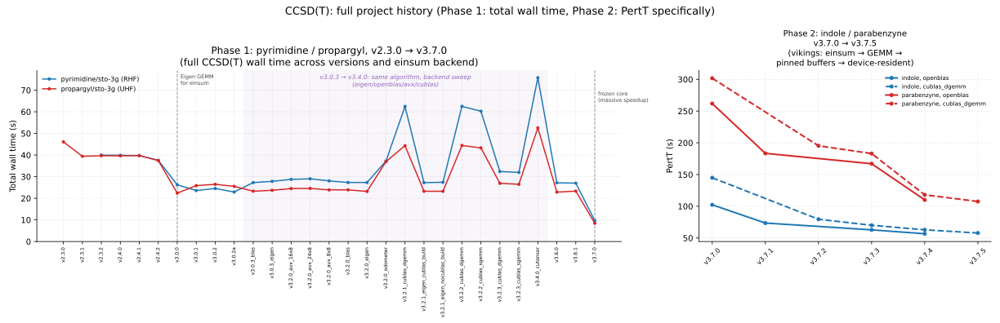
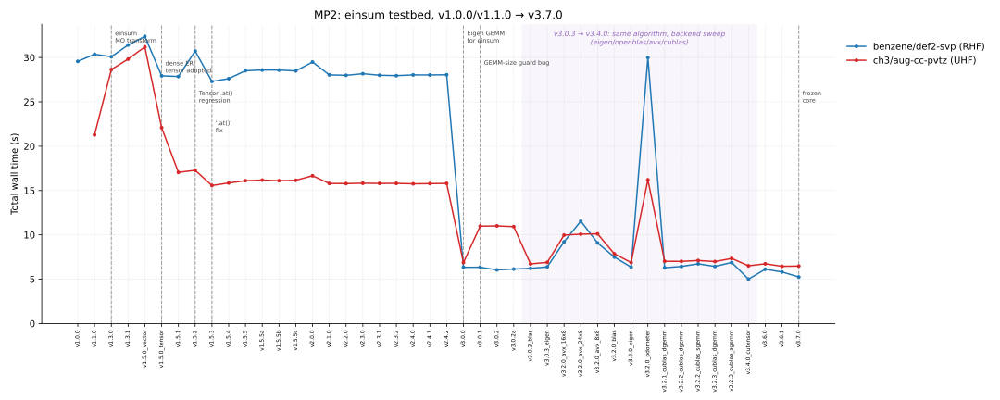
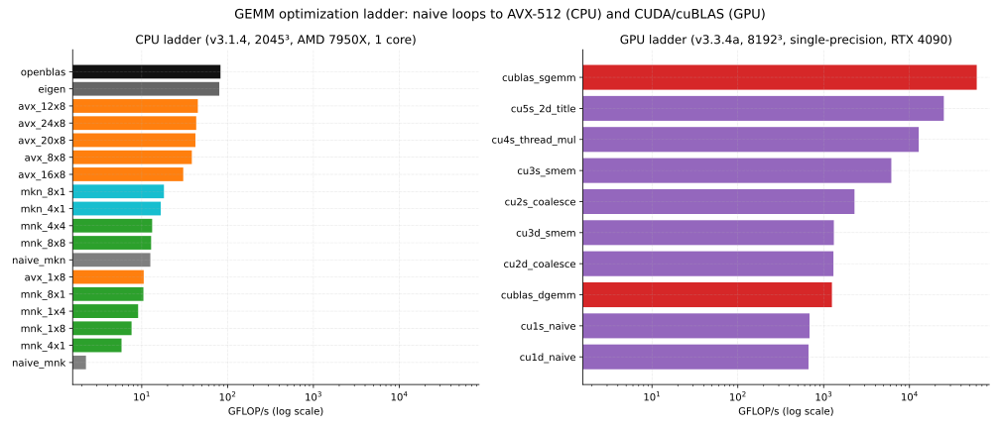

# ESTZero: Electronic Structure Engine built from First Principles

A repository building electronic structure theory methods from the ground up RHF/UHF -> MP2/MP3 -> CCSD/CCSD(T) written in C++. Every layer underneath them are built and explored too: a homemade `Tensor` class with zero-copy views and contiguous logic, an `einsum` contraction engine with its own O(1) odometer index walker, and a GEMM library climbing a ladder from naive triple loops through AVX-512 intrinsics to hand-written CUDA kernels and cuBLAS. Every version was benchmarked and checked against Psi4 for correctness along the way.

> For from-scratch NumPy implementations of the molecular integrals themselves (Obara-Saika recursion for overlap, kinetic, nuclear attraction, and ERI), see [Scratch-Code-Fock](https://github.com/kienkanne/SCF-Scratch_Code_Fock), the Python precursor to this project. Its integral module is under reviewed for contribution for Psi4Numpy. This repository uses [Libint2](https://github.com/evaleev/libint) as its integral backend and focuses on the methods and performance engineering built around it.

## Layout

```
estzero/
├── est/
│   ├── wfn.cc/h          WaveFunction: loads geometry+basis, orchestrates SCF -> post-HF
│   ├── integrals.cc      8-fold-symmetric ERI build (permutational symmetry, Schwarz screening)
│   ├── jk_build.cc/h     Symmetry-driven J/K contraction (single-pass scatter, not dense N^4)
│   ├── rhf.cc / uhf.cc   SCF loops: DIIS, symmetric orthogonalization, SAD/GWH guess
│   ├── transmo.cc/h      AO -> MO integral transform (RHF single-spin, UHF 3-block aa/bb/ab)
│   ├── mp2.cc/h          MP2 correlation energy
│   ├── mp3.cc/h          MP3, built directly on the CC module's intermediates
│   ├── cc_build/cc_iter/cc_spin/cc_spat.cc/h
│   │                     Shared CCSD intermediates + iteration loop; spin-orbital (UHF) vs
│   │                     spatial-orbital (RHF) T1/T2 formulations
│   └── cc_triples.cc/h  CCSD(T): the batched "vikings" perturbative-triples algorithm
├── linalg/
│   ├── tensor.h          One dense array type: row-major, shared_ptr, zero-copy views
│   ├── einsum.cc/h       From scratch einsum: pairwise contraction, GEMM fast path
│   ├── odometer.h        O(1) pers tep index walker shared by einsum and Tensor's own ops
│   └── diis.h/sym_ortho.h  DIIS extrapolation / symmetric orthogonalizer
├── gemm/
│   ├── naive/mkn_RxR/mnk_RxR/avx512.cc
│   │                     Hand-rolled GEMM ladder: naive loops -> register blocking -> AVX-512
│   └── cublas_gemm/cutensor_gemm/cuda_ladder.cc
│                         GPU backends: cuBLAS, cuTENSOR, hand-written CUDA kernels
└── utils/timer.h         Scoped phase timer

bench/    Benchmark + accuracy vs Psi4, the GEMM microbenchmark
docs/     Full performance log/history (docs/PERFORMANCE.md) and the charts above
tests/    doctest suite: oracle-free property tests + Psi4-oracle golden regression tests
```

## References

This repository is inspired by the following projects, which are also the references for the equations and programming materials:

**Electronic Structure Theory**
- Psi4Numpy: https://github.com/psi4/psi4numpy
- CCQC's summer program: https://github.com/CCQC/summer-program
- Dr. Crawford's C++ Programming Projects: https://github.com/CrawfordGroup/ProgrammingProjects
- Dr. Crawford's PyCC: https://github.com/CrawfordGroup/pycc

**General Matrix Multiplication**
- https://github.com/flame/how-to-optimize-gemm
- https://github.com/flame/blislab
- https://github.com/siboehm/SGEMM_CUDA
- https://siboehm.com/articles/22/CUDA-MMM

## Benchmarking

A benchmark + accuracy suite lives in `bench/`. It runs the engine over a tiered test suite and checks every energy against a cached Psi4/PK reference.

```bash
# 1. store Psi4 reference energies:
python bench/gen_reference.py

# 2. benchmark + accuracy check (rebuilds, best-of-3 wall time, PASS/FAIL vs Psi4):
python3 bench/benchmark.py
```

Psi4 options:
```bash
e_convergence 1e-8
d_convergence 1e-8
maxiter 200
scf_type pk # no density-fitting
guess core

mp2_type conv
mp_type conv
cc_maxiter 200
r_convergence 1e-8,

freeze_core true/false # depending on the --frozen-core option
```

## Highlights

There are two ladder tracks for EST and GEMM, and each one benchmarked and logged in [CHANGELOG.md](CHANGELOG.md) as it goes.

Full per-version tables, every raw log, and the complete GEMM microbenchmark ladder live in [docs/PERFORMANCE.md](docs/PERFORMANCE.md)/ These three charts are the summary version.

### CCSD(T): latest progress



Phase 1 (left) is `pyrimidine/sto-3g` (RHF) and `propargyl/sto-3g` (UHF) from v2.3.0 through v3.7.0. There is a noisy plateau at v3.2.0 - v3.4.0 as every `einsum` backend got tried (`odometer`/`eigen`/`openblas`/`avx`/`cublas`/`cutensor`), with the GPU backends repeatedly making things worse until v3.7.0's frozen core approximation cut it to a fraction of its previous value in one step. This made that the systems were too small to keep benchmarking. Phase 2 (right, current) starts there with new larger systems `indole/sto-3g` and `parabenzyne/sto-3g`, v3.7.0 through v3.7.5, first targeting the perbutative triples term, so its time is shown instead of total wall. `einsum` -> direct GEMM -> pinned buffers -> fully device-resident `cublas_dgemm`.

### MP2: testbed from v1.0.0



MP2 started much earlier, so it's shown here to represent the post-HF history. RHF `benzene/def2-svp` were added since v1.0.0 and UHF `ch3/aug-cc-pvtz` since v1.1.0, and it's still benchmarked at v3.7.0, and it's a playground for `einsum`/`Tensor` or any SCF changes. Highlights: v1.3.x first einsum routed replacing explicit loops slowed down, v1.5.0 tensor ERI build instead of smart-index vecotr, v1.5.2/v1.5.3 `Tensor::at()` index lookup cost, and then the same v3.0.0 GEMM massive improvement that MP3 and CCSD(T) also benefited from.

### GEMM ladder: CPU & GPU kernels backend



Left: the CPU ladder (`naive_mnk` -> `mkn`/`mnk` register blocking -> AVX-512 intrinsics -> Eigen/OpenBLAS), climbing from ~2 to ~144 GFLOP/s. Right: the GPU ladder (naive CUDA -> shared-memory tiling -> coalesced access -> cuBLAS), ~666 to ~60,780 GFLOP/s. Both panels share the same log-scale x-axis, showing the GPU GEMM dominance in performance, even for the naive version.
